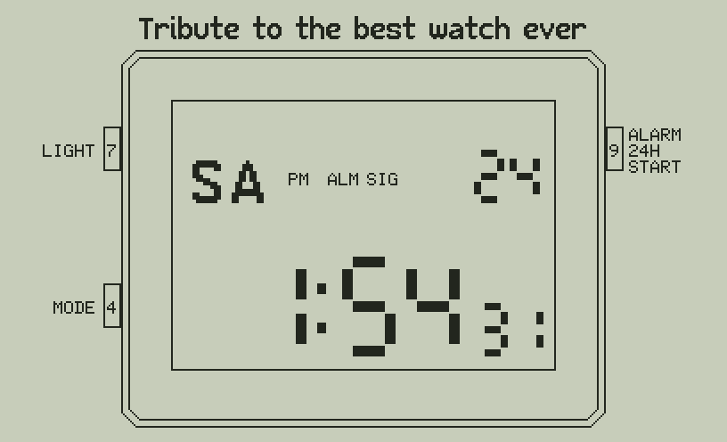

# Watch 47 — a tribute to the classic three-button digital watch, on the C47 / R47

*Tribute to the best watch ever.* `WATCH47` turns the SwissMicros C47 / R47 into the digital watch many of us
wore for decades: the time, date and **seconds from the calculator's clock**, 12 h with **AM / PM** or **24 h**,
the **daily alarm** (it really beeps), the **hourly chime**, the **stopwatch** with split, the **time setting**,
and the **light** — here a pixel dissolve. Its three buttons are the C47 keys **7**, **4** and **9**. The face
is an original drawing in the spirit of the watch, not a copy of any brand's.

## Buttons

| C47 key | Button | |
|---|---|---|
| **7** | LIGHT (upper left) | time: the light (1.5 s); alarm: set; stopwatch: split / reset; setting: the next field |
| **4** | MODE (lower left) | time → alarm (AL) → stopwatch (ST) → time setting → time |
| **9** | ALARM ON-OFF / 24H / START-STOP (right) | time: 12 / 24 h; alarm: on / chime; stopwatch: start / stop; setting: + 1 |
| **0** | | the end: the screen cleared, your stack and LASTx as they were |

The button you press is shown pressed (inverted) on the screen until the next one.

**Standby**: the watch keeps the calculator busy, but if it goes to standby anyway, the key that wakes it ends
WATCH47 cleanly (more than 30 s between two passes of its loop), so the calculator is back in its normal state;
XEQ "WATCH47" starts it again. A longer power-off time in the calculator's setup, if your firmware has one,
keeps the watch on longer.

## The modes

- **Time**: the day of the week (SU MO TU WE TH FR SA), the date, the hours and minutes, the seconds, and the
  indicators AM / PM or 24H, ALM (alarm on), SIG (hourly chime on). The time comes from the calculator's clock,
  read every 0.2 s or so.
- **Easter egg**: press **9 twice quickly** (within 1 s) in the time mode — the watch shows **C47** for 2 s.
  (Two presses switch 12 / 24 h twice, so your setting stays as it was.)
- **Alarm (AL)**: the alarm time. 9 steps through ALM → ALM SIG → SIG → none (alarm and chime on or off).
  7 sets it: the hour flashes, 9 adds one; 7 the minutes, 9 adds one; 7 the hour again; 4 ends the setting.
  Setting the alarm switches it on. At its minute the watch **beeps for 20 s** (BUZZ, 2048 Hz, four beeps a
  second) with ALM flashing; any button stops it. With SIG on it **beeps once on the hour**.
- **Stopwatch (ST)**: minutes, seconds, tenths and hundredths. The C47 counts tenths only (TICKS is 100 ms; its
  own STOPW app shows tenths too), so while it runs the hundredths digit spins like the real watch's blur, and
  stopped or split it shows the tenths and 0. While it runs the display updates about 4 times a second.
  9 start / stop; 7 while running: split (the time stops on the screen, SPL; the stopwatch runs on), 7 again:
  back; 7 when stopped: reset. It keeps running in the other modes. Up to 59'59"9, then round again.
- **Time setting**: the seconds flash; 9 puts them to 00 (from 30 on, to the next minute). 7 moves on: hour,
  minutes, month (shown in the date's place), day; 9 adds one. 4 back to the time. The day of the week follows
  from the date (the year is the calculator's).

## The calculator's clock, and what the watch keeps

The watch shows the calculator's clock plus an offset that the time setting changes: the global variable
**WOFF** (in days; `0 STO "WOFF"` goes back to the calculator's own time). **WSET** keeps 12 / 24 h, the alarm
and chime on or off and the alarm time. Both stay for the next run.

## Before the first run on a C47

The keys 7, 4, 9 and 0 are KEY? codes 52, 62, 54, 82 (checked in your other programs). **New in a program here,
not yet run on a C47**: AGRAPH with **GRMOD 4** (the inverse, for the lit LCD) and **BUZZ** (in your C64
demo, written by hand). TICKS is taken as tenths of a second (as in the firmware's reference and Almanac 47).

## Speed (in the simulator, at Almanac 47's measured 0.17 ms a step)

The start draws the watch in about 6 950 steps (1.2 s); then each tick of the watch (the clock read, the
display: only the cells that change) about 414 steps (70 ms) and a pause of 0.2 s, so the seconds change on
time to about 0.3 s. A pass of the light's dissolve is about 800 steps: the light comes on in about 0.55 s.

## How it is drawn

The LCD's inside is drawn with AGRAPH in bands of 64 rows: each cell (a digit, the colon, the letters, the
indicators) writes its whole columns (GRMOD 1), so nothing needs clearing; lit, the same words are written
inverted (GRMOD 4). The light's effect is four XOR passes of a 4 × 4 ordered dither over the inside: after the
four, the screen is exactly the lit drawing. 7-segment digits (56 and 30 rows), the day letters are the C47's
standard font doubled, the indicators its small font.

## Build and files

| | |
|---|---|
| `programs_rem/WATCH47.txt` | the commented source (STRUCT, named labels) — edit this one |
| `programs/WATCH47.txt`, `build/WATCH47.txt` | the calculator program (to convert with rejig) |
| `build/forum/WATCH47.p47u` | the same program as a commented rejig source (`@` header, comments after `;`) |
| `listings/` | numbered steps with comments, the local labels |
| `python/layout.py` | the screen: digits, letters, indicators, the case, the buttons; `mock()` draws a state |
| `tools/build_watch47.py` | the build: the drawing steps from `layout.py`, the STRUCT numbers, the labels |
| `python/c47sim.py`, `stdfont.py`, `tinyfont.py` | the C47 simulator and fonts, from Almanac 47 (BUZZ and a TICKS hook added, marked watch47) |
| `python/watch47sim.py` | runs WATCH47 with a running clock, writes `docs/*.png` |
| `tests/test_watch47.py`, `tests/test_forum.py` | the tests |
| `tools/make_gif.py` | `docs/WATCH47_tour.gif` |

    python3 tools/build_watch47.py   # programs/, build/, listings/, build/forum/WATCH47.p47u
    python3 tests/test_watch47.py    # the screens against layout.mock, the time against datetime, alarm, chime ...
    python3 tests/test_forum.py
    python3 python/watch47sim.py     # docs/*.png
    python3 tools/make_gif.py        # docs/WATCH47_tour.gif

Size: about 3 460 steps, 13.5 KB (the dither words, the letters' and indicators' columns are most of it);
94 of the 100 local labels; no IF, 4 DO. Calculators: C47 / R47 with STRUCT, ATEXT, GRFNT and BUZZ.
Not yet run on a real C47.

## Credits and licence

Victor Valdes, GNU GPL v3.0 or later (`LICENSE`, `NOTICE`). Written with the help of AI, used responsibly:
see `AI_ASSISTANCE.md`. Fonts: the C43/C47 firmware. SwissMicros, C47, R47 and DM42 are trademarks of their
owners. Not affiliated with any watch maker.
